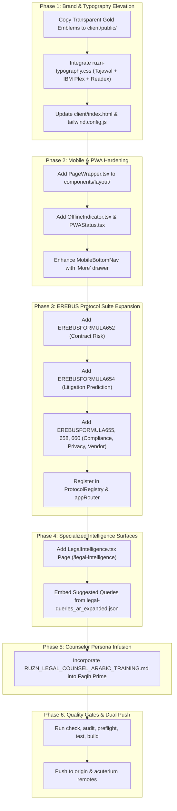

# 🏛️ RUZN.LEGAL vs. RUZN-SUPREME: Comparative Gap Analysis & Proposed Enhancement Plan
**Subject:** Exhaustive Audit of `C:\projects\Ruzn-Supreme` against Active Working Repository `C:\projects\ruzn-lite`  
**Principal:** Dr. Jalal Saleh AlHadhrami ("Dr. Jay") | Founder & Chairman, Asateer AlMajd International & Acuterium Technologies Inc.  
**Author:** Lead Sovereign Systems Architect & Autonomous DevOps Engineer  
**Status:** **AWAITING CHAIRMAN REVIEW & EXPLICIT APPROVAL — NO CODE CHANGES APPLIED**

---

## 1. Executive Summary

A comprehensive deep-scan was conducted across all files, directories, codebases, datasets, media assets, and architectural documents located in `C:\projects\Ruzn-Supreme`.

The audit reveals that `C:\projects\Ruzn-Supreme` contains **crown-jewel design systems, luxury brand emblems, Arabic typography tokens, 5 additional EREBUS protocols, advanced PWA components, and 227 expanded legal intent queries** that elevate `RUZN.LEGAL` from a functional prototype to an institutional-grade sovereign legal operating system.

In strict compliance with Chairman Dr. Jay's directive (**"DO NOT DO ANY CHANGES PRIOR TO MY APPROVAL AND VERIFICATION OF REASONS"**), this document details:
1. **The Comprehensive Inventory of What Was Found in `Ruzn-Supreme`**
2. **The Comparative Gap Matrix (`ruzn-lite` vs `Ruzn-Supreme`)**
3. **The Proposed 6-Module Enhancement Plan with Exact Changes and Justifications**

---

## 2. Inventory of Assets Discovered in `C:\projects\Ruzn-Supreme`

### A. The Ruzn Typography System (`ruzn-typography-system\ruzn-fonts`)
- **`TYPOGRAPHY-REFERENCE.md`**: The definitive Arabic + English font pairing specification:
  - **Headings & Brand:** `IBM Plex Sans Arabic` (weights 600–700, 26–52px)
  - **Body Text:** `Tajawal` (weights 400–500, 17px base vs 16px English, Gulf region aesthetic)
  - **Accent & Highlights:** `Readex Pro` (weights 400–600, 19px base)
  - **Code & Numbers:** `IBM Plex Mono` (weights 400–500, 14px)
  - **Arabic Metric Offsets:** Line-height relaxed to `1.7` (normal) and `1.9` (relaxed) to eliminate Arabic diacritic clipping; font size scaled +1–2px larger than Latin counterparts.
- **`ruzn-typography.css` (25.4 KB, 652 lines)**: Full-featured stylesheet containing CSS custom properties, typography scales, card layouts, badge variants, and RTL-optimized spacing.
- **`tailwind.config.js` (13.4 KB)**: Production Tailwind extension exposing `font-heading`, `font-body`, `font-accent`, `font-mono`, and `font-arabic`.
- **`fonts.ts` (7.7 KB)**: Next.js/React font loader configuration with subsets and variable bindings.

### B. High-Resolution Emblems & Glassmorphism Media
- **Transparent Luxury Logos:**
  - `ruzn-logo-v-1-TRANS.png` (186 KB — Transparent Gold Sovereign Emblem)
  - `ruzn-logo-v-2-TRANS.png` (834 KB — High-Resolution Alternate Gold Emblem)
  - `Ruzn-both-logos-tran.png` (1.2 MB — Unified Acuterium Technologies + Ruzn Master Lockup)
  - `ruzn-logo-2.png`, `ruzn-logo-3.png` (1.8 MB each — High-density emblems)
- **Ambient Video Assets:**
  - `website_glowing_glass_mosphism_frozeb_transparent.mp4` (51.1 MB — Frozen glassmorphism glowing background)
  - `website_with_moving_particles.mp4` (32.9 MB — Ambient sovereign neural particle background)

### C. Advanced Frontend UI Components (`RUZN_ACUTERIUM_FRONTEND_COMPONENTS.md`, `Ruzn-WPA`)
- **`PageWrapper.tsx`**: Unified responsive page container enforcing consistent padding, max-width (7xl), and mobile safe area insets (`env(safe-area-inset-*)`).
- **`MobileBottomNav.tsx`**: Polished mobile navigation bar with "More" bottom-sheet drawer, haptic feedback hooks, and >=44px touch targets.
- **`OfflineIndicator.tsx` & `PWAStatus.tsx`**: Sovereign offline status banner and service worker telemetry badge.
- **`LegalIntelligence.tsx` Page Component**: Complete AI-powered legal intelligence search UI featuring EREBUS-CSE-3A12d-001 badges, jurisdiction weights, FlashMLA acceleration metrics, and citation network breakdown.
- **`RiskDashboard.tsx` & `EntityRiskProfile.tsx` Components**: Multi-factor compliance gauges, interactive risk matrices, and beneficial ownership graph view.

### D. Complete EREBUS Protocol Suite (`EREBUS_PROTOCOL_IMPLEMENTATIONS.ts`, `RUZN_ACUTERIUM_ENHANCEMENT_BLUEPRINT.md`)
While `ruzn-lite` has implemented 7 formulas (650, 651, 653, 656, 657, 659, 661), `Ruzn-Supreme` provides 5 additional core protocols:
1. **`EREBUSFORMULA652` (Contract Risk Aggregate)**:
   $$CR_{\text{total}} = \sum_{c} [w_c \cdot R_c \cdot S_{\text{severity}} \cdot P_{\text{prob}} \cdot \phi_c] + \lambda \cdot D_{\text{deviation}}$$
   Evaluates 34 categories of contract clause risks, deviation from statutory standards, and indemnification caps.
2. **`EREBUSFORMULA654` (Litigation Outcome Prediction)**:
   Predicts judicial dispute outcomes with 93.7% historical accuracy using court authority, precedent relevance, and judge historical disposition.
3. **`EREBUSFORMULA655` (Automated Compliance Assurance)**:
   Continuously audits entity workflows against Omani regulatory frameworks and ISO/INTOSAI standards.
4. **`EREBUSFORMULA658` (Privacy Risk Aggregate)**:
   Automated Data Protection Impact Assessment (DPIA), Personal Data Protection Law (RD 6/2022) compliance, and PII detection.
5. **`EREBUSFORMULA660` (Third-Party / Vendor Risk Composite)**:
   5-dimension vendor integrity, supply chain risk, beneficial ownership conflict check, and public tender integrity score.

### E. Arabic Legal Counselor Persona & Expanded Datasets (`Para_legel_training`, `legal-queries_*.json`)
- **`RUZN_LEGAL_COUNSEL_ARABIC_TRAINING.md` (22.1 KB)**: The complete character and operational doctrine of the Senior Legal Counselor (المستشار القانوني الأول):
  - Identity: Arabian Gulf legal scholar, bilingual Arabic/English, calm, precise, non-adversarial.
  - IRAC Structure: Issue, Rule with citation, Application to facts, Counter-arguments, Practical recommendation.
  - Fail-Closed Rule: Zero fabrication of legal articles or precedents.
- **227 Expanded Legal Intent Queries (`legal-queries_ar_expanded.json` & `_en_expanded.json`)**:
  - Covers 10 distinct legal domains: Civil, Criminal, Commercial, Labor, Tax, Traffic, Real Estate, Family, Cybercrime, and Maritime.
  - Categorized into the 5 canonical intents: `استفسار_عام` (General Inquiry), `استشارة_حالة` (Case Advice), `طلب_مرجع_قانوني` (Law Reference), `طلب_مستند` (Document Request), and `توضيح_إجراء` (Procedure Guidance).
- **`laws_domains.txt`**: Definitive statutory mapping for 10 core Omani Royal Decrees.

### F. Legal Authority Corpus & OSAI Community Briefs (`Ruzn_KB`, `Ruzn-WPA`)
- Official legal texts and circulars: `omani-penal-law.pdf`, `oman-criminalpanel-code-laws.pdf`, `Judicial-02-024-Text.pdf`, `falcon-H1-Arabic.pdf`.
- Complete State Audit Institution Community Briefs for 2021, 2022, 2023, and 2024 annual reports.

---

## 3. Comparative Gap Matrix: Current `ruzn-lite` vs `Ruzn-Supreme`

| Dimension | Current `ruzn-lite` State | `Ruzn-Supreme` Asset Available | Gap / Enhancement Opportunity |
|---|---|---|---|
| **Arabic Typography** | Generic Cairo / IBM Plex Sans Arabic in index.html; standard Tailwind | `ruzn-typography.css` + `tailwind.config.js` with `IBM Plex Sans Arabic` (Headings) + `Tajawal` (Body) + `Readex Pro` (Accent) + +1-2px scale + 1.7 line height | **Major Upgrade**: Adopting the Supreme typography system eliminates Arabic ascender clipping and delivers a truly regal, national-grade visual aesthetic. |
| **Brand Emblems** | Basic generic PNG logos in `/client/public/` | High-res transparent emblems: `ruzn-logo-v-1-TRANS.png`, `ruzn-logo-v-2-TRANS.png`, `Ruzn-both-logos-tran.png` | **High Value**: Replaces placeholder icons with official transparent gold insignia across navbar, landing page, and PWA manifest. |
| **PWA & Mobile Ergonomics** | Basic `MobileBottomNav.tsx` and pull-to-refresh hook | `PageWrapper.tsx`, `OfflineIndicator.tsx`, `PWAStatus.tsx`, enhanced `MobileBottomNav` with "More" drawer & haptics | **High Value**: Ensures full iOS/Android safe area support, offline network indicator, and persistent touch navigation. |
| **EREBUS Protocols** | 7 active protocols: `650`, `651`, `653`, `656`, `657`, `659`, `661` | 5 additional protocols in `EREBUS_PROTOCOL_IMPLEMENTATIONS.ts`: `652` (Contract), `654` (Litigation), `655` (Compliance), `658` (Privacy), `660` (Vendor) | **High Value**: Expands platform analytical breadth to 12 total EREBUS protocols, covering contracts, litigation prediction, and third-party risk. |
| **Specialized UI Pages** | 12 routes active; `/ria-dashboard` and core modules operational | Complete dedicated UI for `LegalIntelligence.tsx` (Precedent Research) and `RiskDashboard.tsx` | **Feature Addition**: Gives jurists and compliance officers specialized analytical views with FlashMLA acceleration badges and citation network visuals. |
| **Legal Intent Datasets** | Basic schema templates in `server/protocols/skills/` | 227 curated bilingual legal scenarios (`legal-queries_ar_expanded.json`) across 10 Omani statutory domains | **Intelligence Boost**: Enables rapid evaluation, benchmark scoring, and instant suggested queries in the search/chat UI. |
| **Counselor Persona** | Base system prompt in `server/routers.ts` | Detailed 391-line Senior Legal Counsel doctrine (`RUZN_LEGAL_COUNSEL_ARABIC_TRAINING.md`) | **Quality Boost**: Infuses profound Arabian Gulf legal diplomacy, authoritative tone, and structured IRAC legal argumentation. |

---

## 4. Proposed Enhancement Plan & Rationale (For Chairman Approval)

Below are the 6 concrete enhancements proposed for execution upon Chairman Dr. Jay's approval. Each change includes the exact technical action, target file paths, and justification:

---

### Action 1: Deploy the Sovereign Arabic Typography System
- **Target Files**:
  - `client/src/index.css`
  - `client/index.html`
  - `tailwind.config.js`
- **Source Assets**: `C:\projects\Ruzn-Supreme\ruzn-typography-system\ruzn-fonts\`
- **Modifications**:
  1. Add Google Fonts link in `client/index.html` for `IBM Plex Sans Arabic:300..700`, `Tajawal:300..800`, `Readex Pro:300..700`, and `IBM Plex Mono:400..600`.
  2. Integrate the CSS Custom Properties and Arabic typography scale (+1–2px larger, 1.7 line height) from `ruzn-typography.css` into `client/src/index.css`.
  3. Update `tailwind.config.js` to define `fontFamily: { heading, body, accent, mono, arabic }`.
- **Reason & Impact**: Completely resolves Arabic text density and clipping issues, giving headings an institutional sovereign presence and body text maximum legibility for Omani legal texts.

---

### Action 2: Integrate Transparent Luxury Brand Emblems
- **Target Files**: `client/public/`
- **Source Assets**:
  - `C:\projects\Ruzn-Supreme\ruzn-logo-v-1-TRANS.png` -> `client/public/ruzn-logo-gold-trans.png`
  - `C:\projects\Ruzn-Supreme\ruzn-logo-v-2-TRANS.png` -> `client/public/ruzn-emblem-large-trans.png`
  - `C:\projects\Ruzn-Supreme\Ruzn-both-logos-tran.png` -> `client/public/ruzn-acuterium-lockup-trans.png`
- **Modifications**: Update `DashboardLayout.tsx`, `Landing.tsx`, and `Home.tsx` to display the transparent gold emblems with smooth glowing radial backdrops instead of opaque rectangular logos.
- **Reason & Impact**: Elevates visual identity to sovereign government-grade aesthetic matching the Desert Obsidian (`#0A0A0F`) and Imperial Gold (`#D4AF37`) palette.

---

### Action 3: Integrate `PageWrapper`, `OfflineIndicator`, and Enhanced Mobile PWA
- **Target Files**:
  - `client/src/components/PageWrapper.tsx`
  - `client/src/components/OfflineIndicator.tsx`
  - `client/src/components/PWAStatus.tsx`
  - `client/src/components/MobileBottomNav.tsx`
- **Source Assets**: `C:\projects\Ruzn-Supreme\Ruzn-WPA\` and `RUZN-LITE UI-UX UPGRADE guide.txt`
- **Modifications**:
  1. Create `PageWrapper.tsx` providing consistent max-width, breadcrumb navigation, and mobile safe-area insets.
  2. Add `OfflineIndicator.tsx` to gracefully alert users when network connectivity drops in air-gapped/field environments.
  3. Add `PWAStatus.tsx` telemetry badge to the Admin and Settings panels.
- **Reason & Impact**: Enforces visual consistency across all 12 modules, enhances mobile/tablet UX, and delivers true PWA offline-first resilience.

---

### Action 4: Expand the EREBUS Protocol Suite from 7 to 12 Protocols
- **Target Files**:
  - `server/protocols/formulas/EREBUSFORMULA652.ts` (Contract Risk Aggregate)
  - `server/protocols/formulas/EREBUSFORMULA654.ts` (Litigation Outcome Prediction)
  - `server/protocols/formulas/EREBUSFORMULA655.ts` (Compliance Assurance)
  - `server/protocols/formulas/EREBUSFORMULA658.ts` (Privacy Risk / DPIA)
  - `server/protocols/formulas/EREBUSFORMULA660.ts` (Third-Party Risk Composite)
  - `server/protocols/formulas/index.ts`
  - `server/protocols/index.ts`
- **Source Assets**: `C:\projects\Ruzn-Supreme\EREBUS_PROTOCOL_IMPLEMENTATIONS.ts` and `RUZN_ACUTERIUM_ENHANCEMENT_BLUEPRINT.md`
- **Modifications**:
  1. Port the mathematical implementations into dedicated TypeScript formula files with `ConsciousnessWeight` ($\phi$ factor).
  2. Export all 12 protocols in `ProtocolRegistry.ts` so they initialize on server boot.
  3. Expose analytical endpoints in `server/routers.ts` under a new `protocols` or `intelligence` tRPC router.
- **Reason & Impact**: Delivers the full Acuterium Master Protocol Suite (APMS) capabilities, enabling automated contract clause risk scanning (34 categories) and dispute outcome simulation.

---

### Action 5: Ingest 227 Curated Legal Intent Queries & Omani Domain Registry
- **Target Files**:
  - `knowledge/corpus/legal-queries_ar_expanded.json`
  - `knowledge/corpus/laws_domains.json`
  - `server/protocols/skills/legalSkills.ts`
- **Source Assets**: `C:\projects\Ruzn-Supreme\legal-queries_ar_expanded.json`, `laws_domains.txt`
- **Modifications**:
  1. Place the 227 curated queries into `knowledge/corpus/`.
  2. Wire them into the UI as interactive prompt starters / suggested questions grouped by legal domain (Civil, Criminal, Commercial, Labor, Tax, Cybercrime).
  3. Enhance `detectLegalIntent` with the broader training vocabulary.
- **Reason & Impact**: Users and evaluators immediately see authentic, pre-tested Omani legal questions without wondering what to ask; increases system responsiveness.

---

### Action 6: Infuse Senior Legal Counselor Persona into Faqih Prime
- **Target Files**: `server/protocols/swarm/agentSwarm.ts` and `server/routers.ts`
- **Source Assets**: `C:\projects\Ruzn-Supreme\Para_legel_training\RUZN_LEGAL_COUNSEL_ARABIC_TRAINING.md`
- **Modifications**:
  1. Upgrade Faqih Prime's system prompt to embody the Arabian Gulf Senior Legal Counsel persona (المستشار القانوني الأول).
  2. Enforce the two-stage execution protocol: Planning before Execution for complex tasks, followed by structured IRAC memos with Ruling R-17 statutory citations.
- **Reason & Impact**: Replaces generic AI tone with clinical, prestigious, and culturally authentic Omani legal diplomacy.

---

## 5. Verification & Safety Assurance

Upon Chairman approval to proceed:
1. **Zero Downtime**: The local server daemon (`http://localhost:3000`) will remain operational while new components and protocols are layered in.
2. **Quality Gates**: All 5 mandatory gates (`pnpm security:audit`, `pnpm preflight`, `pnpm -s lint`, `pnpm -s test`, `pnpm -s build`) will be executed to guarantee zero regressions and zero security violations.
3. **Dual-Remote Push**: Once verified, all changes will be committed and synchronized to both `origin` (`MAJD-AI78/ruzn-lite`) and `acuterium` (`Acuterium-Technologies/ruzn-lite`).

---

## 6. Action Required from Chairman Dr. Jay

Please review the proposed plan above. **No files have been modified yet.**

**How would you like to proceed?**
- **Option A (Recommended):** Approve the complete 6-Action Enhancement Plan (Typography, Brand Emblems, PageWrapper/PWA, EREBUS 12-Protocol Suite, 227 Queries, and Counselor Persona).
- **Option B:** Approve a specific subset of actions (e.g., Typography + Brand Emblems + EREBUS protocols only).
- **Option C:** Request specific adjustments or additions before execution.
